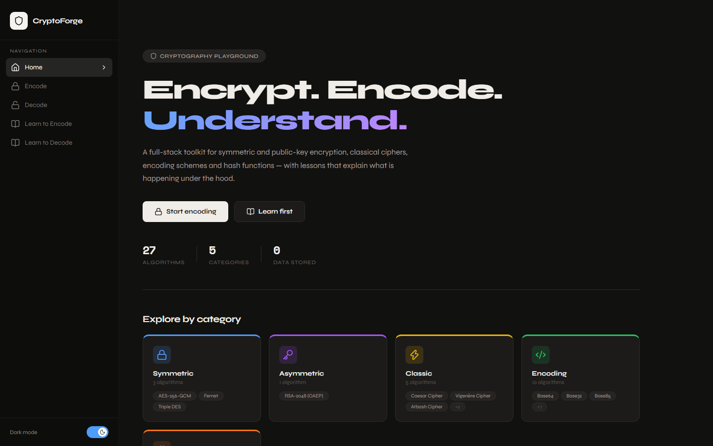
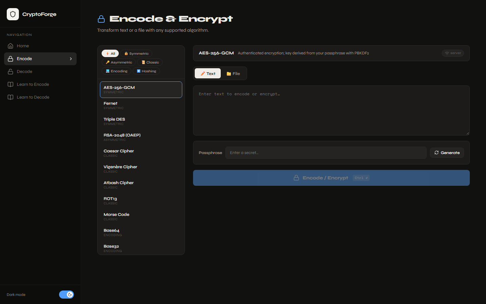

# 🔐 CryptoForge

**A full-stack cryptography playground.** Encrypt, decode and hash text or files with 27 algorithms — AES-256-GCM, RSA-OAEP, Fernet, classical ciphers, encodings and hash functions — and learn how each one works.

**🌐 Live demo: [cryptoforge-nu.vercel.app](https://cryptoforge-nu.vercel.app)** · API docs: [cryptoforge-api.vercel.app/docs](https://cryptoforge-api.vercel.app/docs)

[](https://github.com/thearcanetechie-hue/Cryptoforge/actions/workflows/ci.yml)





## ✨ Features

- **27 algorithms in 5 categories**
  - 🔒 **Symmetric** — AES-256-GCM, Fernet, Triple DES (legacy)
  - 🔑 **Asymmetric** — RSA-2048 with OAEP/SHA-256, with in-app key-pair generation
  - 📜 **Classical** — Caesar, Vigenère, Atbash, ROT13, Morse
  - 💻 **Encoding** — Base64, Base32, Base85, Hex, Binary, Octal, Decimal, Unicode, URL, HTML entities
  - #️⃣ **Hashing** — SHA-256/512, SHA3-256/512, BLAKE2b/s, SHA-1, MD5
- **Private by default** — encodings, classical ciphers and SHA hashes run entirely in the browser; only real encryption goes to the API, and nothing is ever stored
- **File mode** — Base64/Hex/Binary-encode a file, or compute its SHA-256 checksum to verify a download
- **Encrypt → decrypt in one click** — "Decode it" sends the ciphertext and key straight to the decoder
- **Clear errors** — a wrong key says *"wrong key or tampered ciphertext"* instead of returning garbage
- **Lessons** — step-by-step explanations, worked examples and pitfalls for every technique, each with a *Try it* button
- **Polished UI** — dark/light theme that follows your system, responsive down to phone size, keyboard shortcut (Ctrl/⌘ + Enter)

## 🏗️ How it works

```
┌────────────────────────── Browser (React + Vite) ──────────────────────────┐
│  Encodings · classical ciphers · SHA-1/256/512 (Web Crypto)  →  instant,   │
│                                                                 offline    │
│  AES · Fernet · 3DES · RSA · Base32/85 · SHA-3 · BLAKE2 · MD5 ──────┐      │
└─────────────────────────────────────────────────────────────────────┼──────┘
                                                                      ▼
                                  ┌──────────── FastAPI (Python) ─────────────┐
                                  │  crypto_ops.py  ←  pyca/cryptography      │
                                  │  stateless: no database, no logging of    │
                                  │  plaintext or keys                        │
                                  └───────────────────────────────────────────┘
```

Algorithms implemented in both places produce **byte-for-byte identical output**. `backend/parity.py` generates expected results from the Python code, and the frontend test suite checks the JavaScript implementation against them.

### Security design

| Choice | Why |
|---|---|
| **AES-256-GCM** (authenticated) | Detects a wrong key or tampered ciphertext instead of silently decrypting to garbage |
| **PBKDF2-HMAC-SHA256, 600,000 iterations**, random 16-byte salt | Turns a human passphrase into a 256-bit key and slows brute-force guessing ([OWASP 2023](https://cheatsheetseries.owasp.org/cheatsheets/Password_Storage_Cheat_Sheet.html)) |
| Random 12-byte nonce per message | Encrypting the same text twice gives different ciphertext |
| **RSA-OAEP with SHA-256** | Randomised padding; avoids the padding-oracle attacks on PKCS#1 v1.5 |
| Input limits (1 M chars, 5 MB files) | Keeps the API from being used for resource exhaustion |

AES output format: `Base64( salt[16] ‖ nonce[12] ‖ ciphertext ‖ tag[16] )`

> CryptoForge is a learning tool. Use audited software for protecting real secrets.

## 🚀 Run it locally

**Prerequisites:** Python 3.12+ and Node.js 20+.

**1. Backend** (http://localhost:8000, interactive docs at `/docs`)

```bash
cd backend
python -m venv .venv
# Windows: .venv\Scripts\activate    macOS/Linux: source .venv/bin/activate
pip install -r requirements.txt
uvicorn main:app --reload
```

**2. Frontend** (http://localhost:5173)

```bash
cd frontend
npm install
npm run dev
```

The frontend works without the backend for in-browser algorithms; it shows a notice for the ones that need the API.

## 🧪 Tests

```bash
cd backend && pip install -r requirements-dev.txt && pytest     # 105 tests
cd frontend && npm test                                          # 169 tests
```

Backend tests round-trip every reversible algorithm with Unicode input, check known test vectors, wrong keys, tampering, RSA size limits and malformed input. Frontend tests check browser/Python parity and the main user flows. GitHub Actions runs both suites, ESLint and a production build on every push.

## 🔌 API

| Method | Path | Body / params | Returns |
|---|---|---|---|
| `GET` | `/algorithms` | — | Algorithms grouped by category |
| `POST` | `/encode` | `{ "text", "algorithm", "key"? }` | `{ "result", "algorithm", "operation" }` |
| `POST` | `/decode` | `{ "text", "algorithm", "key"? }` | `{ "result", "algorithm", "operation" }` |
| `POST` | `/generate-key/{algorithm}` | `aes`, `3des`, `fernet`, `rsa` | `{ "key" }` or `{ "public_key", "private_key" }` |
| `POST` | `/encode-file?algorithm=` | multipart `file` (≤ 5 MB) | `{ "result", "filename", "algorithm" }` |

Errors return HTTP 400 with a human-readable `detail`.

```bash
curl -X POST http://localhost:8000/encode \
  -H "Content-Type: application/json" \
  -d '{"text": "Hello World", "algorithm": "aes", "key": "my passphrase"}'
```

## ☁️ Deploy

Both halves deploy to [Vercel](https://vercel.com) as separate projects from this repo:

1. **API** — import the repo, set *Root Directory* to `backend`. Optionally set `ALLOWED_ORIGINS` to your frontend URL.
2. **Frontend** — import again with *Root Directory* `frontend`, and set `VITE_API_URL` to the API URL from step 1.

## 📁 Project structure

```
cryptoforge/
├── backend/
│   ├── main.py            # FastAPI routes, validation, CORS
│   ├── crypto_ops.py      # All algorithms + registry (pure functions)
│   ├── parity.py          # Generates shared fixtures for the frontend
│   └── tests/             # pytest suite
├── frontend/
│   └── src/
│       ├── lib/           # codecs.js (browser crypto), api.js, shared JSON fixtures
│       ├── pages/         # Home, EncoderDecoder, LearnEncode, LearnDecode
│       └── components/    # Sidebar, FileDrop, Lessons
└── .github/workflows/     # CI
```

## 🛠️ Tech stack

**Frontend:** React 19, React Router 7, Vite 8, Web Crypto API, Lucide icons, hand-written CSS (no UI library) · **Backend:** Python 3.12, FastAPI, pyca/cryptography · **Quality:** pytest, Vitest, Testing Library, ESLint, GitHub Actions

## 📄 License

[MIT](LICENSE) © Samikshya Swoyamjita
